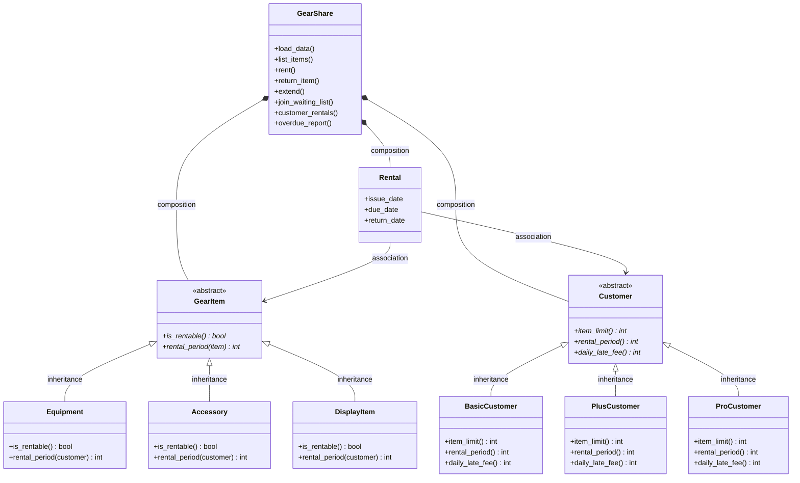

# GearShare Phase 1 Design

## Class diagram

## Relationships

- `Equipment`, `Accessory`, and `DisplayItem` are inheritance relationships with `GearItem`: each is a kind of gear and substitutes for its common abstract item behavior.
- `BasicCustomer`, `PlusCustomer`, and `ProCustomer` are inheritance relationships with `Customer`: each is a customer membership type with different policy values.
- `GearShare` has a composition relationship with its collections of gear items, customers, and rentals because the service owns and coordinates the in-memory records for this console application.
- A `Rental` has an association with its `GearItem`: it records which item is on loan.
- A `Rental` has an association with its `Customer`: it records who has borrowed the item.

## Abstract-class contracts

`GearItem` requires every subclass to implement `is_rentable()` and `rental_period(customer)`: equipment and accessories have their own rentable-period behavior, while a display item reports that it is not rentable and supplies no rental period.

`Customer` requires every subclass to implement polymorphic `item_limit()`, `rental_period()`, and `daily_late_fee()` methods; the concrete membership classes supply the Basic, Plus, or Pro values without tier-based branching in the service logic.

The item-limit, rental-period, and fee choices do not contain membership checks such as `if tier ==`; calling the same method on each concrete `Customer` selects the appropriate behavior.

## CRC cards

### GearItem

- **Responsibilities:** Store common item data, validate common item state, expose rentable and rental-period behavior.
- **Collaborators:** `Equipment`, `Accessory`, `DisplayItem`, `Rental`.

### Equipment

- **Responsibilities:** Represent equipment, report itself as rentable, and apply the customer's equipment rental period.
- **Collaborators:** `GearItem`, `Customer`.

### Accessory

- **Responsibilities:** Represent accessories, report itself as rentable, and enforce a two-day rental period regardless of membership.
- **Collaborators:** `GearItem`, `Customer`.

### DisplayItem

- **Responsibilities:** Represent display-only gear and report that it cannot be rented.
- **Collaborators:** `GearItem`, `GearShare`.

### Customer

- **Responsibilities:** Store shared customer data and define the membership policy contract.
- **Collaborators:** `BasicCustomer`, `PlusCustomer`, `ProCustomer`, `Rental`.

### BasicCustomer

- **Responsibilities:** Provide Basic limits and rates: two items, three days, and a 50-per-day late fee.
- **Collaborators:** `Customer`, `GearShare`.

### PlusCustomer

- **Responsibilities:** Provide Plus limits and rates: four items, five days, and a 100-per-day late fee.
- **Collaborators:** `Customer`, `GearShare`.

### ProCustomer

- **Responsibilities:** Provide Pro limits and rates: eight items, seven days, and a 150-per-day late fee.
- **Collaborators:** `Customer`, `GearShare`.

### Rental

- **Responsibilities:** Store the customer, item, issue date, due date, return date, extension count, and computed late state for one loan.
- **Collaborators:** `Customer`, `GearItem`, `GearShare`.

### GearShare

- **Responsibilities:** Load data, coordinate catalogue lookup, enforce rule ordering and exceptions, manage rentals and waiting lists, and produce reports.
- **Collaborators:** `GearItem`, `Customer`, `Rental`.

## Think about this: Phase 1

1. Raising a specific exception is better than returning `False` because it identifies which rule failed and preserves the deterministic error message; `False` would make every caller lose the rule, customer/item context, and reason needed for both UI and testing.
2. If R4 (unpaid fines) were checked before R3 (item limit), Rohan Das's request for another item would report his fine limit before the normal item-limit result, and the message would also depend on which limit he has already reached.
3. Fine calculation should live on `Rental`, because the fee depends on that rental's due and return dates and the customer's current tier policy; `GearShare` would own cross-object policy incorrectly, while `Customer` would lack the return-date data unless it also held the whole rental history.
4. A Basic-to-Pro upgrade should apply the new Pro limit and fee behavior when each policy is evaluated from the customer's current polymorphic methods, but it should not rewrite existing rentals; their historical due dates remain unchanged, while return calculations may use the current or captured tier rate depending on the implemented policy, and this needs to be chosen explicitly rather than inferred by the recording types.
