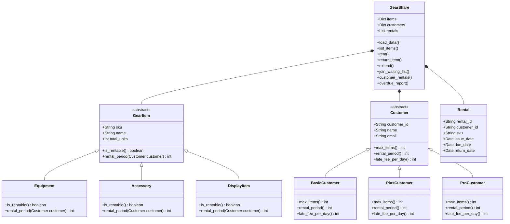

# GearShare Phase 1 Design

## Class diagram

## Relationships

- `Equipment` is an inheritance (is-a) relationship with `GearItem` because equipment is a kind of gear with a customer-dependent rental period.
- `Accessory` is an inheritance (is-a) relationship with `GearItem` because an accessory is gear that always has a two-day rental period.
- `DisplayItem` is an inheritance (is-a) relationship with `GearItem` because display merchandise is gear that cannot be rented.
- `BasicCustomer` is an inheritance (is-a) relationship with `Customer` because a Basic customer is a customer with the Basic limits and rates.
- `PlusCustomer` is an inheritance (is-a) relationship with `Customer` because a Plus customer is a customer with the Plus limits and rates.
- `ProCustomer` is an inheritance (is-a) relationship with `Customer` because a Pro customer is a customer with the Pro limits and rates.
- `GearShare` has a composition (has-a) relationship with `GearItem` because the service owns the in-memory item catalogue.
- `GearShare` has a composition (has-a) relationship with `Customer` because the service owns the customer records used for rentals.
- `GearShare` has a composition (has-a) relationship with `Rental` because the service owns the rental history and open rentals.

## Abstract contracts

`GearItem` forces `Equipment`, `Accessory`, and `DisplayItem` to implement `is_rentable()` and `rental_period(customer)` so callers can ask any item for its rental behavior without inspecting an item type.

`Customer` forces `BasicCustomer`, `PlusCustomer`, and `ProCustomer` to implement `max_items()`, `rental_period()`, and `late_fee_per_day()` so each membership supplies its own policy through one interface.

Membership and item behavior contain no `if tier ==` checks; polymorphic method dispatch selects the concrete implementation.

## CRC cards

| Class | Responsibilities | Collaborators |
|---|---|---|
| GearItem | Store common item data, validate its identity and stock, expose abstract rental behavior. | Equipment, Accessory, DisplayItem, Rental |
| Equipment | Report that it is rentable and obtain the customer tier rental period. | GearItem, Customer |
| Accessory | Report that it is rentable and enforce a fixed two-day period. | GearItem, Customer |
| DisplayItem | Report that it is not rentable and provide no rental period. | GearItem, GearShare |
| Customer | Store shared customer identity and define the membership policy contract. | BasicCustomer, PlusCustomer, ProCustomer |
| BasicCustomer | Supply two-item limit, three-day period, and 50-per-day fee. | Customer, GearShare |
| PlusCustomer | Supply four-item limit, five-day period, and 100-per-day fee. | Customer, GearShare |
| ProCustomer | Supply eight-item limit, seven-day period, and 150-per-day fee. | Customer, GearShare |
| Rental | Store one loan, its dates, return state, and extension count. | GearShare, Customer, GearItem |
| GearShare | Load data, coordinate catalogue operations, enforce rules, manage waiting lists, and produce reports. | GearItem, Customer, Rental |

## Think about this

1. `rent()` should raise a specific exception because a caller needs to know which rule failed and can present that reason; `False` loses the cause and prevents useful deterministic handling.
2. Moving R4 before R3 would change Rohan Das's request: the system would report unpaid fines instead of a customer item-limit error.
3. Fine calculation is best on `Rental` for the due and return dates that determine lateness, although `GearShare` coordinates policy and application; fine calculation does not fit naturally on `Customer` because one customer can have many rentals with different dates.
4. An upgrade should change policy for current future checks such as limits and late fees, while existing due dates remain historical; this is easy when policy is polymorphic, but unclear without an explicit decision about whether fees use the tier held when each rental was issued or the tier current at return.
